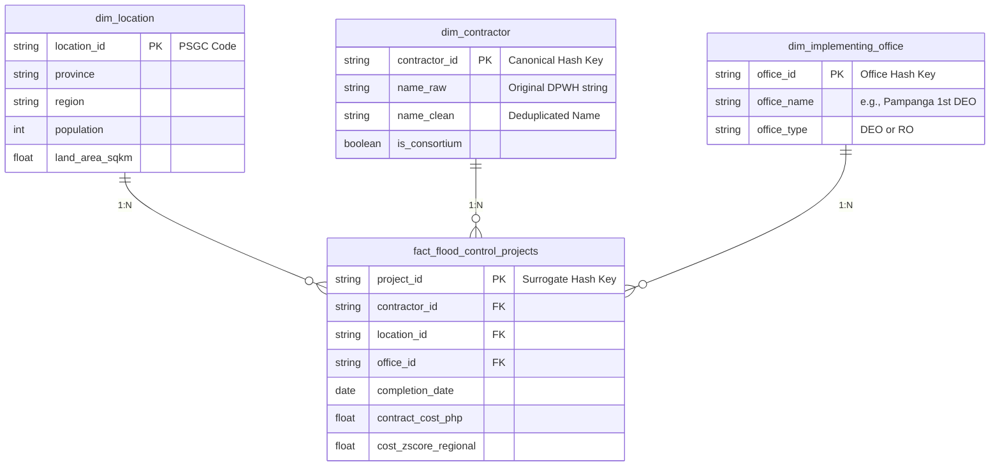

# Public Data Patterns in DPWH Flood Control Projects (2022–2025)

## Problem Statement

I want to answer:
**"Can publicly available DPWH flood control project data reveal unusual geographic, financial, and contractor-related patterns that may indicate areas requiring further audit or investigation between 2022 and 2025?"**

My hypothesis is that while most flood control projects are distributed according to infrastructure and disaster mitigation needs, the data may reveal patterns that warrant closer examination. These may include unusually high concentrations of projects within specific provinces, repeated awards to the same contractors, or significant differences in project costs across comparable locations. Such patterns do **not** establish corruption, fraud, or wrongdoing. Instead, they provide evidence-based indicators that can help auditors, policymakers, journalists, and citizens identify projects that deserve further review. If the analysis finds no unusual concentrations or inconsistencies, it would suggest that the observed project distribution is generally consistent with available public data. If notable anomalies are identified, the findings could support stronger transparency initiatives, more detailed public reporting, and more targeted oversight by government auditing agencies.

---

## Audience

- **Primary Audience:** **Commission on Audit (COA) — Infrastructure Audit Division** (to assist in identifying high-risk geographic clusters and prioritizing physical/financial field audits).
- **Secondary Audience:** Department of Public Works and Highways (DPWH) internal oversight, Local Government Units (LGUs), investigative journalists, civil society organizations (CSOs), and citizens interested in infrastructure transparency.

---

## KPI or Key Metric

- **Primary Metric:** **Contractor Concentration Ratio** (Percentage share of total regional/provincial flood control project value awarded to top contractors).
- **Secondary / Supporting Metrics:**
  - **Cost Anomaly Z-Score:** Statistical deviation of unit/km project cost relative to regional benchmarks.
  - **Geographic Investment Density:** Total project allocation per province/municipality normalized by land area and population.
  - **Contractor Project Volume:** Total count and aggregate contract value of completed projects per contractor.

---

## Possible Final Dashboard

The dashboard should help audit teams and researchers quickly identify geographic hotspots with high contractor concentration, pinpoint cost outliers among completed projects, and filter by province or region to flag specific project IDs for further review. It will feature interactive choropleth maps, contractor distribution rankings, cost dispersion scatter plots, and regional summary tables.

---

## Data Source Notes

### Primary Source
- **Name:** DPWH Flood Control Projects Dataset (Kaggle)
- **URL:** https://www.kaggle.com/datasets/bwandowando/dpwh-flood-control-projects
- **Format:** CSV
- **Coverage:** 9,855 completed DPWH flood control project records nationwide (July 2022 – May 2025)
- **Raw Data Path:** `data/raw/dpwh_flood_control_projects.csv` (Pulled: 2026-09-26)
- **Why it fits:** Provides structured, project-level metadata—including contract amounts, contractor names, project titles, coordinates, and implementing offices—enabling direct calculation of contractor concentration, cost variances, and spatial distribution.
- **Known limitations:** Covers completed projects only and relies on self-reported government entries subject to ongoing coordinate inaccuracies under review.

### Fallback Source
- **Name:** DPWH Project DIME (Digital Information for Monitoring and Evaluation) Dashboard
- **URL:** https://www.dime.gov.ph/dashboard
- **Format:** HTML Web Dashboard / Downloadable Reports
- **Coverage:** National infrastructure project monitoring status
- **Why it could still work:** Acts as an independent government monitoring baseline to validate project existence, financial details, and implementation status if the primary mirror becomes unavailable.
- **Known limitations:** Field schema differs from the Kaggle dataset, requiring manual table extraction and custom field mapping.

### Secondary / Normalization Sources
- **Philippine Statistics Authority (PSA):** https://psa.gov.ph (CSV / Excel / PDF) — Provides regional population and land area data to normalize project density and cost allocation per capita.
- **Commission on Audit (COA) Annual Audit Reports:** https://www.coa.gov.ph (PDF) — Provides qualitative audit findings to cross-reference and ground statistical outliers.

---

# Phase 3 / Milestone 3 — Clean Dataset

## Overview

This project is now at the Phase 3 / Milestone 3 stage: a clean, structured, and reproducible dataset for downstream audit analysis and SQL-based review.

Current processed outputs include:

- `data/processed/dpwh_flood_control_projects_cleaned.csv`
- `data/output/analysis/` for grouped summaries and review flags

The repo is structured so a reviewer can run the full pipeline from raw input to analysis output without guessing the order.

---

## Pipeline

```text
data/raw/dpwh_flood_control_projects.csv
        |
        v
scripts/transform.py
        |
        +--> data/processed/dpwh_flood_control_projects_cleaned.csv
        |
        v
scripts/analysis/analyze_silver.py
        |
        +--> data/output/analysis/
```

The project follows a clear raw-to-processed-to-analysis flow:

1. Download the raw source data
2. Clean and standardize the dataset
3. Save the processed dataset
4. Generate analysis outputs for review and audit screening

---

## Processed Schema

### Main processed table

**File:** `data/processed/dpwh_flood_control_projects_cleaned.csv`

**Grain:** one row = one project record

**Primary key idea:** each row is retained as one cleaned project record, with validation checks ensuring the dataset does not silently lose integrity during transformation.

**Key expected columns:**

- `ProjectId`
- `ContractId`
- `FundingYear`
- `Region`
- `Province`
- `Municipality`
- `DistrictEngineeringOffice`
- `Contractor`
- `ApprovedBudgetForContract`
- `ContractCost`
- `ProjectTitle`
- `TypeOfWork`
- `StartDate`
- `CompletionDate`

This is the working data table for downstream analysis and audit screening.

---

## Cleaning Decisions

The transform script applies the following rules:

- standardizes inconsistent column names
- strips whitespace and normalizes text values
- converts numeric fields to numeric data types where appropriate
- removes exact duplicate rows
- preserves missing values where they are meaningful instead of silently discarding them
- keeps the dataset deterministic by sorting cleaned records in a stable order

The cleaning log and validation notes are documented in `scripts/README.md`.

---

## Validation

Validation checks are built into `scripts/transform.py`.

The pipeline checks:

- raw row count is preserved after cleaning
- key combinations remain unique
- required project columns are present
- output data remains structurally consistent before writing

This makes the transform reproducible and easier for reviewers to validate.

---

## SQL Business Questions

SQL queries are stored in:

- `sql/business_questions.sql`
- `sql/schema_ddl.sql`

The project currently answers three business questions:

1. Which contractors received the largest total contract value?
2. Which provinces received the highest total flood control funding?
3. Which District Engineering Offices manage the highest average project costs?

These queries directly support the project’s audit-oriented analysis and align with the DEP milestone requirement for SQL business questions.

---

## Reproducibility

The transform process is designed to be reproducible:

- same raw file + same transform script = same cleaned output structure
- validation checks ensure the cleaned file stays structurally consistent
- output ordering is stable by key columns

This is important for a reviewer who wants to re-run the pipeline and confirm that the same dataset is produced.

---

## Run the Phase 3 Pipeline

Install dependencies:

```bash
pip install -r requirements.txt
```

Run ingestion:

```bash
python scripts/ingest.py
```

Run transformation:

```bash
python scripts/transform.py
```

Run analysis:

```bash
python scripts/analysis/analyze_silver.py \
  --input data/processed/dpwh_flood_control_projects_cleaned.csv \
  --output-dir data/output/analysis
```

---

## Milestone 3 Checklist

- [x] Processed dataset saved in `/data/processed/`
- [x] Schema plan documented
- [x] SQL business questions documented and saved in `sql/`
- [x] Missing values and cleaning decisions documented
- [x] Validation checks integrated into the transform flow
- [x] Reproducible script flow documented for reviewers

This Phase 3 output is the clean foundation for later analysis, deeper audit review, and dashboard-ready outputs.

---

# Phase 4 / Milestone 4 — Initial Insights

## Overview

This project has completed the Phase 4 / Milestone 4 pass focused on exploratory analysis and initial insight generation for the DPWH flood control project dataset.

The full working notebook is:

- `notebooks/M4_initial_insights.ipynb`

This phase answers the project question:

> Can publicly available DPWH flood control project data reveal unusual geographic, financial, and contractor-related patterns that may warrant further audit review?

The analysis is intentionally framed as exploratory and investigative, not as proof of wrongdoing or misconduct. The goal is to identify patterns worth deeper validation.

---

## M4 Scope

The M4 notebook follows the milestone structure:

1. Week 13 — Descriptive statistics
2. Week 14 — EDA and visualization (5 core charts)
3. Week 15 — Inference with analytical caution
4. Week 16 — Narrative insights and review shortlist

---

## Working Outputs

Key M4 deliverables include:

- descriptive baseline statistics for project volume, cost, and regional variation
- cost outlier analysis using regional z-score benchmarking
- contractor concentration analysis by province
- geographic concentration and project volume comparison by region
- statistical checks for whether observed patterns exceed a simple random baseline
- summary narrative for audit-oriented interpretation

Relevant files:

- `notebooks/M4_initial_insights.ipynb`
- `docs/week_13_descriptive_statistics.md`
- `output/figures/` (generated chart outputs)

---

## M4 Summary Findings

### Geographic patterns
- Project volume and value are uneven across regions.
- Region III stands out as the largest concentration of projects and total spending.
- Regional variation suggests that geography and project mix matter when comparing patterns.

### Financial patterns
- Contract costs are right-skewed, with a long tail of large-value projects.
- A subset of projects is flagged as unusually high-cost relative to their regional baseline.
- Roughly 3.3% of projects are flagged as high-cost outliers, with some regions showing materially higher rates.

### Contractor patterns
- National contractor concentration is limited, but provincial concentration can be much higher.
- Some provinces show a single contractor accounting for a large share of local project value.
- This indicates that concentration is not random and may be worth investigating in context.

### Analytical caution
- These patterns are statistically distinguishable from a naive random model.
- However, they do not establish wrongdoing or corruption by themselves.
- Additional validation is required using project type, province size, and external references.

---

## M4 Review Checklist

- [x] Descriptive statistics executed and interpreted
- [x] EDA conducted with 5 labelled charts
- [x] Cost outlier patterns reviewed
- [x] Contractor concentration reviewed by province
- [x] Statistical inference included with caution
- [x] Final insights narrative documented
- [x] Limitations and next steps identified

---

## Interpretation

The M4 pass confirms that the public data can reveal patterns worth closer audit review. These findings are best understood as leads for investigation rather than final conclusions.

The next phase (M5) should focus on:

1. cleaning contractor names and handling joint ventures consistently
2. normalizing geography with PSA population and land-area data
3. benchmarking costs by project type and size
4. validating flagged projects against government monitoring sources
5. preparing the final dashboard and stakeholder-ready brief

---

## Phase 5 — Path B: Segmentation, KPIs and Stakeholder Brief

**Path:** B (Alt Track). The project question calls for description and prioritising review, not prediction.

### Run the full pipeline

```bash
pip install -r requirements.txt
python scripts/run_pipeline.py                 # transform -> analysis-ready -> Phase 5 analysis
# python scripts/run_pipeline.py --with-ingest  # also downloads the raw data (needs Kaggle credentials)
jupyter notebook notebooks/M5_segmentation_kpis_brief.ipynb
```

### Phase 5 outputs

| Output | Location |
|---|---|
| Segmentation, KPI and brief notebook | `notebooks/M5_segmentation_kpis_brief.ipynb` |
| Analysis script (shared with the notebook) | `scripts/analysis/m5_segmentation_kpis.py` |
| Segment, KPI and shortlist tables | `data/processed/m5_*.csv` |
| Charts 6–9 | `output/figures/m5_*.png` |
| One-page stakeholder brief | `docs/stakeholder_brief.pdf` |

### Milestone 5 Checklist

- [x] Segmentation notebook section (3 dimensions)
- [x] 5 KPI definitions with trend over time
- [x] 1-page stakeholder brief
- [x] Clean, runnable pipeline (`scripts/run_pipeline.py`)
- [x] `requirements.txt` updated

---

## 🏗️ Storage Design & Data Architecture

This project follows a 3-tier **Medallion Architecture**:

1. **Bronze Layer (`data/raw/`):** Immutable raw CSV landing zone (`dpwh_flood_control_projects.csv`) ingested via manual download or Kaggle API.
2. **Silver Layer (`data/processed/`):** Standardized, deduplicated, and canonicalized Parquet dataset (cleaning contractor names, validating GPS coordinates, parsing dates, and mapping PSGC boundaries).
3. **Gold Layer (Analytics):** Analytical Star Schema aggregating contractor concentration, provincial spend per capita, and cost anomaly z-scores.

### Project Dependencies
- **Primary Python Modules:** `pandas`, `kaggle`, `pathlib`, `os`, `geopandas`

### Dimensional Data Model (Gold Layer Schema)


### Processed Data Plan & Table Specifications

**Main Fact Table:** `fact_flood_control_projects`
- **Grain:** One row = One completed DPWH flood control project contract
- **Primary Key:** `project_id`

| Column | Meaning | Expected Type |
| :--- | :--- | :--- |
| `project_id` | Unique identifier generated from contract title and ID metadata | String |
| `contractor_id` | Identifier for the winning contractor or joint venture | String |
| `location_id` | Standard Geographic Code (PSGC) linking to province/municipality | String |
| `office_id` | Identifier for the implementing DPWH District Engineering Office | String |
| `contract_cost_php` | Total reported project contract cost in Philippine Pesos | Float |
| `completion_date` | Date the project was logged as completed | Date |
| `cost_zscore_regional` | Statistical deviation of project cost relative to regional mean | Float |
| `latitude` | Validated GPS latitude coordinate | Float |
| `longitude` | Validated GPS longitude coordinate | Float |

...

### Related Dimensions

* `dim_contractor`: Joins on `contractor_id` to aggregate contractor market concentration ratios (top-N share) and total contract volume.
* `dim_location`: Joins on `location_id` to pull PSA provincial population and land area for normalizing spend per capita.
* `dim_implementing_office`: Joins on `office_id` to categorize projects by District Engineering Office (DEO) versus Regional Office (RO).

## 💻 Quickstart & Ingestion

### Setup Environment

```bash
# Clone the repository
git clone https://github.com/michaelbacus-lab/dep-data-engineering-open-track.git
cd dep-data-engineering-open-track

# Create and activate virtual environment
python -m venv .venv
source .venv/bin/activate  # On Windows: .venv\Scripts\activate

# Install requirements
pip install -r requirements.txt
```

### Run Raw Ingestion
```bash
python scripts/ingest.py
```
## ⚠️ Data Quality & Investigation Limitations Disclaimer
- `Self-Reported Data Vulnerabilities`: **This dataset reflects DPWH's self-reported submissions, which have been subject to formal Senate Blue Ribbon Committee inquiry and internal DPWH validation regarding coordinate accuracy and potential non-existent ("ghost") entries.**

- `Validation Context`: **As of DPWH internal validation efforts in late 2025, 15 projects out of 1,600 validated sites were confirmed non-existent, with roughly 160 locations pending verification. Additionally, Senate committee inquiries noted allegations of inaccurate grid coordinates across nationwide submissions.**

- `Analytical Scope`: **Findings from this project serve as data-driven indicators warranting further physical verification and audit, not definitive proof of legal wrongdoing or fraud.**
