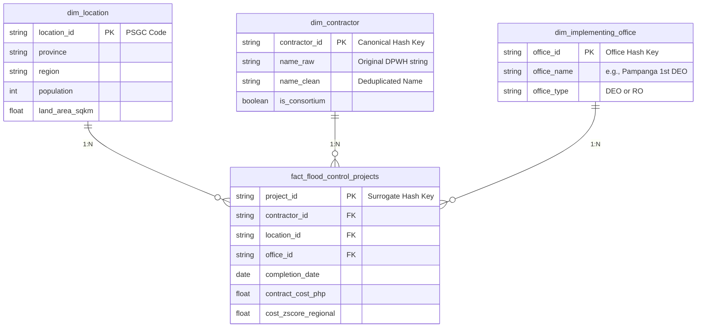

# Public Data Patterns in DPWH Flood Control Projects (2022–2025)

## Problem Statement

I want to answer:
**"Can publicly available DPWH flood control project data reveal unusual geographic, financial, and contractor-related patterns that may indicate areas requiring further audit or investigation between 2022 and 2025?"**

My hypothesis is that while most flood control projects are distributed according to infrastructure and disaster mitigation needs, the data may reveal patterns that warrant closer examination. These may include unusually high concentrations of projects within specific provinces, repeated awards to the same contractors, or significant differences in project costs across comparable locations. Such patterns do **not** establish corruption, fraud, or wrongdoing. Instead, they provide evidence-based indicators that can help auditors, policymakers, journalists, and citizens identify projects that deserve further review. If the analysis finds no unusual concentrations or inconsistencies, it would suggest that the observed project distribution is generally consistent with available public data. If notable anomalies are identified, the findings could support stronger transparency initiatives, more detailed public reporting, and more targeted oversight by government auditing agencies.

---

## Audience

- **Primary Audience:** **Commission on Audit (COA) — Infrastructure Audit Division** (to assist in identifying high-risk geographic clusters and prioritizing physical/financial field audits).
- **Secondary Audience:** Department of Public Works and Highways (DPWH) internal oversight, Local Government Units (LGUs), investigative journalists, civil society organizations (CSOs), and citizens interested in infrastructure transparency.

---

## KPI or Key Metric

- **Primary Metric:** **Contractor Concentration Ratio** (Percentage share of total regional/provincial flood control project value awarded to top contractors).
- **Secondary / Supporting Metrics:**
  - **Cost Anomaly Z-Score:** Statistical deviation of unit/km project cost relative to regional benchmarks.
  - **Geographic Investment Density:** Total project allocation per province/municipality normalized by land area and population.
  - **Contractor Project Volume:** Total count and aggregate contract value of completed projects per contractor.

---

## Likely Data Source

The primary dataset for this project is the **[DPWH Flood Control Projects Dataset on Kaggle](https://www.kaggle.com/datasets/bwandowando/dpwh-flood-control-projects)** (9,855 rows, July 2022 – May 2025).

---

## Possible Final Dashboard

The dashboard should help audit teams and researchers quickly identify geographic hotspots with high contractor concentration, pinpoint cost outliers among completed projects, and filter by province or region to flag specific project IDs for further review. It will feature interactive choropleth maps, contractor distribution rankings, cost dispersion scatter plots, and regional summary tables.

---

## Data Source Notes

### Primary Source
- **Name:** DPWH Flood Control Projects Dataset (Kaggle)
- **URL:** https://www.kaggle.com/datasets/bwandowando/dpwh-flood-control-projects
- **Format:** CSV
- **Coverage:** 9,855 completed DPWH flood control project records nationwide (July 2022 – May 2025)
- **Why it fits:** Provides structured, project-level metadata—including contract amounts, contractor names, project titles, coordinates, and implementing offices—enabling direct calculation of contractor concentration, cost variances, and spatial distribution.
- **Known limitations:** Covers completed projects only and relies on self-reported government entries. Data is subject to ongoing coordinate inaccuracies and potential non-existent ("ghost") project entries under Senate and internal review.

### Fallback Source
- **Name:** DPWH Project DIME (Digital Information for Monitoring and Evaluation) Dashboard
- **URL:** https://www.dime.gov.ph/dashboard
- **Format:** HTML Web Dashboard / Downloadable Reports
- **Coverage:** National infrastructure project monitoring status
- **Why it could still work:** Acts as an independent government monitoring baseline to validate project existence, financial details, and implementation status if the primary mirror becomes unavailable.
- **Known limitations:** Field schema differs from the Kaggle dataset, requiring manual table extraction and custom field mapping.

### Secondary / Normalization Sources
- **Philippine Statistics Authority (PSA):** https://psa.gov.ph (CSV / Excel / PDF) — Provides regional population and land area data to normalize project density and cost allocation per capita.
- **Commission on Audit (COA) Annual Audit Reports:** https://www.coa.gov.ph (PDF) — Provides qualitative audit findings to cross-reference and ground statistical outliers.

---

## Pipeline Architecture & Requirements

## 🏗️ Storage Design & Data Architecture

This project follows a **Medallion Architecture** pattern, taking raw CSV ingest through a clean Silver transformation layer into an analytical Gold Star Schema.

- **Bronze Layer (`data/raw/`):** Immutable raw CSV landing zone (`dpwh_flood_control_projects.csv`).
- **Silver Layer (`data/processed/`):** Cleaned, deduplicated, and canonicalized columnar Parquet dataset.
- **Gold Layer (Analytics):** OLAP Star Schema for outlier analytics and contractor concentration queries.

### Dimensional Data Model (Gold Layer Schema)

### Project Dependencies
- **Primary Python Modules:** `pandas`, `kaggle`, `pathlib`, `os`, `geopandas`

### Data Pipeline Strategy (Medallion Architecture)
1. **Bronze Layer:** Raw ingestion of the Kaggle DPWH dataset via manual download or Kaggle API into `data/raw/`.
2. **Silver Layer:** Clean contractor names, standardize geographic boundaries (Region/Province/LGU), parse project dates, validate GPS coordinates, and join PSA demographic data.
3. **Gold Layer:** Build analytical tables aggregating contractor market concentration, provincial spend per capita, and statistical cost anomaly scores for dashboard consumption.

---

## Data Quality & Investigation Limitations Disclaimer

- **Self-Reported Data Vulnerabilities:** This dataset reflects DPWH's self-reported submissions, which have been subject to formal Senate Blue Ribbon Committee inquiry and internal DPWH validation regarding coordinate accuracy and potential non-existent ("ghost") entries. 
- **Validation Context:** As of DPWH internal validation efforts in late 2025, 15 projects out of 1,600 validated sites were confirmed non-existent, with roughly 160 locations pending verification. Additionally, Senate committee inquiries noted allegations of inaccurate grid coordinates across nationwide submissions.
- **Analytical Scope:** Findings from this project serve as **data-driven indicators warranting further physical verification and audit**, not definitive proof of legal wrongdoing or fraud.

---

## Data Specifications

### Raw Data Metadata
- **File Path:** `data/raw/dpwh_flood_control_projects.csv`
- **Source:** DPWH Flood Control Projects Dataset (Compiled by Kaggle user `bwandowando` from public DPWH records)
- **Ingestion Method:** Manual download (DEP-approved path)
- **Pulled On:** 2026-09-26
- **Row Count:** 9,855 rows
- **Repeatability:** Downloadable directly via the Kaggle URL. Future pulls may differ if the upstream maintainer updates the dataset version.

## Processed Data Plan

### Main Table or File
- **Name:** `fact_flood_control_projects` (Gold Layer) / `processed_dpwh_flood_control.parquet` (Silver Layer)
- **Grain:** One row = One completed DPWH flood control project contract
- **Primary key:** `project_id`

### Important Columns
| Column | Meaning | Expected Type |
|--------|---------|---------------|
| `project_id` | Unique identifier generated from contract title and ID metadata | String |
| `contractor_id` | Identifier for the winning contractor or joint venture | String |
| `location_id` | Standard Geographic Code (PSGC) linking to province/municipality | String |
| `office_id` | Identifier for the implementing DPWH District Engineering Office | String |
| `contract_cost_php` | Total reported project contract cost in Philippine Pesos | Float |
| `completion_date` | Date the project was logged as completed | Date |
| `cost_zscore_regional` | Statistical deviation of project cost relative to regional mean | Float |
| `latitude` | Validated GPS latitude coordinate | Float |
| `longitude` | Validated GPS longitude coordinate | Float |

### Related Tables or Files
- `dim_contractor`: Joins on `contractor_id` to aggregate contractor market concentration ratios (top-N share) and total contract volume.
- `dim_location`: Joins on `location_id` to pull PSA provincial population and land area for normalizing spend per capita.
- `dim_implementing_office`: Joins on `office_id` to categorize projects by District Engineering Office (DEO) versus Regional Office (RO).
